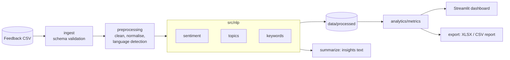

# InsightLens


Turn raw customer feedback (reviews, survey comments, support tickets) into **sentiment, topics, keywords and a
shareable report**. It ships as a set of composable CLI steps plus an interactive Streamlit dashboard. It supports
Portuguese and English text.

## Architecture



| Path | Purpose |
|---|---|
| `src/dataio` | CSV reader/writer and schema validation |
| `src/preprocessing` | Text cleaning, normalisation (spaCy lemmatisation), language detection |
| `src/nlp` | Sentiment, topic modelling, keyword extraction, summaries |
| `src/analytics` | KPIs and aggregates |
| `src/dashboard` | Streamlit app with Upload, Sentiment, Keywords and Topics pages |
| `config/*.yaml` | App, NLP and dashboard configuration |
| `scripts/` | CLI entry points |

## Input format

CSV with the columns `id, date, text, rating, source, lang`. Data is validated on ingestion and bad rows are reported.

## Run it

```bash
python -m venv .venv && source .venv/bin/activate        # Windows: .venv\Scripts\activate
pip install -r requirements.txt
python -m spacy download en_core_web_sm
cp .env.example .env

# Dashboard
streamlit run src/dashboard/app.py

# Pipeline from the command line
python scripts/analyze.py data/interim/feedback_clean.csv --name demo   # sentiment + topics + keywords
python scripts/summarize.py data/processed/<analysed>.csv --lang en     # insights text
python scripts/export_report.py data/processed/<analysed>.csv --fmt xlsx
```

`data/raw`, `data/interim` and `data/processed` are git-ignored: put your own datasets there.

## Configuration

| File | Controls |
|---|---|
| `config/app.yaml` | Paths, default language, column names, UI limits |
| `config/nlp.yaml` | spaCy model, sentiment thresholds, keyword method |
| `config/dashboard.yaml` | Dashboard pages and charts |

Environment variables (`.env.example`): `INSIGHTLENS_ENV`, `INSIGHTLENS_DEFAULT_LANG`, `INSIGHTLENS_DATA_DIR`,
`INSIGHTLENS_LOG_LEVEL`. `NLP_API_KEY` is a placeholder for an optional external NLP provider and is not required.

## Stack

Python, pandas, NumPy, scikit-learn, spaCy, NLTK, Streamlit, Matplotlib, Seaborn, WordCloud, PyYAML.

## License

[MIT](LICENSE)
